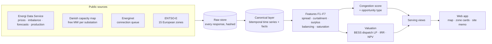

<div align="center">

# ⚡ Grid Feasibility Scanner

**Where in the power grid does a battery, a flexible load or a data centre make money, and how much?**

A data platform that turns scattered public energy-market data into a ranked, explainable answer for every price zone and substation, starting with Denmark.


-2E7D32)


</div>

---

## The problem

Anyone siting a grid-scale battery, a flexible industrial load or a modular data centre asks the same three questions:

| | Question | Why it is hard |
|---|---|---|
| 📍 | **Where** is the grid stressed in a way that pays? | The signals (price spreads, negative prices, curtailment, balancing activations, substation capacity) sit in dozens of sources, formats, time resolutions and zone codes. Some only exist as interactive maps. |
| 🔋 | **Which** asset fits that place? | A battery wants volatile prices and free capacity. A data centre wants cheap surplus power and room to draw load. The same substation can suit one and block the other. |
| 💶 | **How much** would it earn? | Revenue depends on dispatch, which depends on 15-minute prices, efficiency, state-of-charge limits and cycling, so it has to be simulated, not guessed. |

The scanner answers all three in one place, and every number can be traced back to its source data, method and assumptions.

## What it does



1. **Ingests** Danish and European market data on a schedule: day-ahead prices (15-minute since Oct 2025), imbalance and balancing prices, wind and solar forecasts and actuals, reserve markets, the national substation capacity map and the grid-connection queue.
2. **Computes grid-stress features** per zone and substation:

   | Feature | Measures |
   |---|---|
   | F1 Price spread | Daily max–min price, and the DK1–DK2 spread |
   | F2 Curtailment proxy | Share of zero/negative-price intervals and wind+solar shortfall during them |
   | F4 Renewable surplus | (Wind + solar − consumption) / consumption |
   | F5 Balancing activation | How often the grid needs up/down regulation, and imbalance-vs-spot spread |
   | F7 Substation saturation | Free MW for consumption and production at each substation |

3. **Scores and classifies** every zone and municipality: a 0–100 congestion score from weighted percentiles, with the full breakdown stored, and rule-based matching to an opportunity type (battery, demand-side flexibility, or modular data centre).
4. **Values the asset**: a linear program dispatches a battery against every day of real prices and reports a revenue range in EUR per MW per year, plus NPV, IRR and payback.
5. **Serves it** to a web front end: a zone map, zone cards with "why is this zone stressed", ranked sites, and a per-site investment memo (pick a substation, an asset type and a size in MW).

<!--
## Screenshots
Add docs/img/map.png and docs/img/memo.png, then uncomment this block.

| Map and ranked sites | Site memo |
|---|---|
|  |  |
-->

## How the battery valuation works

For each day, the scanner solves a linear program over that day's prices at native resolution (quarter-hours since October 2025):

$$
\max \sum_t p_t\,(d_t - c_t)\,\Delta t
\quad\text{s.t.}\quad
s_t = s_{t-1} + \left(\eta_c c_t - \tfrac{d_t}{\eta_d}\right)\Delta t,\;
0 \le c_t, d_t \le P,\;
s_{\min}E \le s_t \le s_{\max}E
$$

with a daily cycling limit and the battery ending the day as it started. It is solved with HiGHS (`scipy.optimize.linprog`). Daily revenues are summed into rolling 365-day windows, and the lowest and highest windows give the range. The battery parameters (2-hour duration, 87 % round-trip efficiency) are sourced from the Danish Energy Agency's technology catalogue and versioned as an assumption file, not hard-coded.

The result is labelled honestly: *zone-level, perfect-foresight upper bound, day-ahead arbitrage only*. The known biases (perfect foresight, no balancing revenue, no degradation, no market saturation) are shown next to the number.

## Engineering choices worth noting

- **Bitemporal storage.** Every value records when it was valid and when it was known, so a backtest only sees data that existed at the time.
- **Native resolution, UTC, half-open intervals.** The Danish switch from hourly to 15-minute prices on 1 Oct 2025 and daylight-saving days are handled explicitly and tested.
- **Never invent a number.** Gaps stay gaps; a day with a missing interval is skipped and counted, never filled. Capacity data is stored exactly as published (free MW stays free MW, not a made-up percentage).
- **Full reproducibility.** Every score and valuation row records its scenario, the content hash of each assumption file, the method version and the run ID.
- **Scenarios.** Weights, thresholds and asset parameters live in versioned YAML scenarios, so you can compare "what if" runs side by side.
- **Source fingerprinting.** Each ingest checks status, schema and row counts. If a source changes or breaks, the write is blocked and an alert is raised.
- **AI-assisted development with guardrails.** Much of the adapter and parser code was built by LLM coding agents working from written specs, with human-owned definitions, CI gates and 19 architecture decision records (`docs/adr/`) keeping them on track.

## Tech stack

| Layer | Tools |
|---|---|
| Language & packaging | Python 3.12, uv, ruff, mypy (strict on core) |
| Data | Polars, DuckDB, pandera, PostgreSQL 16 + PostGIS, dbmate migrations |
| Orchestration | Dagster (assets, partitions, asset checks, schedules) |
| Ingestion | httpx + tenacity, Playwright, pdfplumber / PyMuPDF |
| Optimisation & finance | scipy `linprog` (HiGHS), NPV / IRR / payback / LCOS |
| Geospatial | PostGIS, shapely, pyproj |
| Serving | PostgREST / Supabase views, static exports |
| Front end | Lovable (React) |
| Quality | pytest + hypothesis (400+ tests), GitHub Actions CI, contract checks |
| Infra | Docker Compose, single-VPS deployment |

## Repository map

```text
src/scanner/
  adapters/     one folder per source: energidataservice, entsoe, energinet, kapacitetskort
  core/         time conventions, manifests, codebook, raw store, DB loading
  runtime/      ingest, snapshots, capacity map, scenarios, export, report
  features/     F1–F7 at zone, substation and municipality level
  scores/       congestion score and opportunity rules
  valuation/    BESS dispatch LP and financial metrics
  assets/       Dagster wrappers
  cli.py        every command; `pipeline` runs the whole chain
db/migrations/  SQL schema (raw → core → feat → val → serving)
assumptions/    versioned asset templates, weights and scenarios
docs/           architecture, data model, methods, ADRs, source dossiers
tests/          offline tests on recorded real-source fixtures
```

## Run it locally

```sh
cp .env.example .env
uv sync --all-groups
docker compose up -d db postgrest
make migrate
make test
uv run python -m scanner.cli pipeline   # load curated → features → scores → valuation → export
uv run dagster dev -w workspace.yaml    # orchestration UI
```

More detail: `docs/architecture.md`, `docs/features.md`, `docs/valuation.md` and `infra/README.md`.

## Roadmap

- Battery revenue stack beyond day-ahead: intraday, aFRR / mFRR / FCR reserves, forecast-based (not perfect-foresight) dispatch
- Full data-centre and demand-side flexibility models
- Italy and Hungary on top of ENTSO-E
- Forecasting, benchmarked against naive baselines before anything is served

## Context

Built as a team project around the Implement × Lovable hackathon (October 2026).

<!-- My role: add 2–3 lines on what you built. -->
