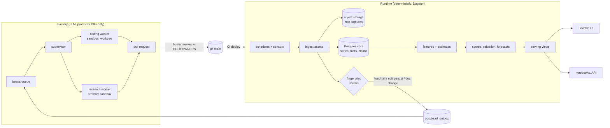

# Architecture

This document describes how the scanner works once it is complete. `MASTER_PLAN.md` says in what order it gets built; the ADRs record why each choice was made.

## The two systems

The runtime never depends on an agent run succeeding. The factory never holds production credentials. The only path from the factory into production is a merged commit. The only path from the runtime into the factory is the bead outbox. The PDF fallback (ADR 0009) is the one LLM call inside the runtime, and its output waits for approval.

## Data layers

Raw captures are stored exactly as received, keyed `raw/<source>/<dataset>/<yyyy>/<mm>/<dd>/<run_id>-<seq>.<ext>` under `RAW_STORE_URL`, with a JSON sidecar holding request parameters, response headers, fetch time and SHA-256. The database refers to a capture relative to the store root, as `raw://<source>/<dataset>/...`, resolved through `RAW_STORE_URL` on read (`scanner.core.raw_store`), so the store can move without rewriting references. Identical content is stored once per source and dataset (backfill reuse, unchanged pages): a later capture keeps its own reference and sidecar, whose `content_uri` points to the capture holding the bytes. Anything downstream can be rebuilt from raw.

The canonical layer has two shapes. Dense series are `core.series` (one row per series, with measure, codebook entry, zone or entity, unit, resolution, kind, source dataset, sensitivity) and `core.observation` (one row per interval and revision). Sparse knowledge is `core.fact` (an attribute of an entity, valid over a period, known from a time), `core.claim` (a figure extracted from a document with its citation) and `core.source_document` (every document we hold). Reference data lives in `ref`: countries, zones, entities and aliases, codebook entries, market rules, sources and datasets. See `docs/data-model.md`.

Features and estimates (`feat.feature_value`, `core.estimate`) are written by Dagster assets with run ID and code version. Scores (`feat.score`) store their full breakdown. Valuation results live in `val`. Forecasts are written back as series of kind `forecast` with `issued_at` and model ID, next to the forecasts sources publish.

Consumers read `serving` views or the canonical layer. They never read adapter internals or raw captures directly.

## How data stays current

Each adapter ships manifests (`src/scanner/adapters/<source>/manifests/*.yaml`) that declare dataset, series, resolution, schedule, watermark field, lookback window, expected intervals, freshness SLA, sensitivity and licence. `scanner.assets.ingest` builds one Dagster asset per manifest, partitioned by local day. A run fetches its local day minus the manifest's lookback (plus its lookahead, for sources that publish ahead), stores raw, fingerprints the partition day, parses, and writes changed rows only. Backfills are the same code over many days, run through `scanner.cli ingest`, which reuses wide responses where a source's limits require it (ADR 0019).

Storage growth stays small by three rules. A manifest may set `recent_lookback`: its frequent schedule ticks then fetch only that window before the tick, while the 01:30 yesterday run keeps the full `lookback` and so captures late revisions. `scanner.cli prune --keep N [--yes]` (weekly, `schedule_prune_feature_runs`, N = 14) deletes feature runs beyond the newest N per feature unless a served score or an approved scenario's output names them (`scanner.runtime.prune`; scores name their feature runs in `breakdown.features.*.run_id`). `scanner.cli catch-up` and the hourly `sensor_catch_up` ingest local days without a full-day run in `ops.ingest_run`, and list blocked days, short days and current-state-only sources as gaps (`scanner.runtime.catchup`).

Downstream assets depend on ingest assets, and the daily compute job (15:30 Europe/Copenhagen) recomputes features, scores, valuation and the export, so new data reaches serving without intervention. A series that misses its freshness SLA shows as `stale` in `serving.source_freshness`; alerting a named person is planned (WP2.8).

Dagster runs separate code locations (`workspace.yaml`): `ingestion`, `analytics` and `ops` (run-failure and staleness alerts), so a broken analytics import never stops ingestion. `ingestion` holds the ingest, snapshot and capacity-map assets, the curated loader and their schedules; each ingest asset shows its normalisation rules (manifest, codebook, precedence, fingerprint thresholds, the dossier's Decisions). `analytics` holds features, scores, valuation and serving, declares the ingestion assets it reads as external specs with the same keys, and shows every assumption set, scenario file and method card as an observable asset whose data version is the file's hash: the UI shows what is computed, from what, with which assumptions, and which outputs a changed file has made stale. Scores and valuation are partitioned by scenario; one daily run loads the curated files, computes the features once and every scenario (`infra/README.md`, "Code locations").

The snapshot watcher (`scanner.assets.snapshots`) polls sources that only show current state, and watched documents, on the schedules in `registry/snapshots.yaml`. It stores every capture, records the hash, and when a hash changes it triggers the matching parser asset or files a research bead.

## How the factory keeps the runtime working

When a hard check fails, the runtime marks the source degraded, keeps serving the last good data with a staleness label, and writes an outbox entry with the failing raw capture's URI. The supervisor turns it into a bead; the capture becomes the new fixture; a worker reproduces the failure offline, fixes the adapter and opens a PR; a human merges; the next scheduled run succeeds. Research beads (new sources, changed documents, new countries) follow the same path through the research workers. See `docs/factory.md`.

## Country model

Countries are configuration (ADR 0011). ENTSO-E is the base tier for every country; national sources enrich it. Geography is a hierarchy: country, bidding zone, TSO or DSO area, substation or node, site. Market design is dated data in `market_rules/`. Features branch on rule values, never on country codes.

## Governance

The codebook defines every measure and its equivalence class (ADR 0012). Sensitivity classes and row-level security keep NDA, customer and personal data out of public outputs and out of agent contexts (ADR 0008). CODEOWNERS routes every curated change to its domain owner (ADR 0014). The testing system in `docs/quality.md` covers adapters, runs, cross-source agreement and outcomes.

## Deployment

The whole runtime runs as one docker compose stack (ADR 0015): Postgres with PostGIS, PostgREST serving the `serving` schema to the anonymous role, Dagster (webserver, daemon, code locations) and the raw store. Locally that is the developer machine with the raw store on disk; in production it is a single Hetzner VPS with the raw store on a local MinIO (S3 API), PostgREST behind HTTPS, and the Dagster UI reachable only privately. Every endpoint is an environment variable, so the database can later move to Supabase and the raw store to Cloudflare R2 without code changes. Images are built and deployed only on a manual trigger. Details: `infra/README.md`. The factory runs on a separate machine from the runtime, so a compromised worker cannot reach production secrets.
